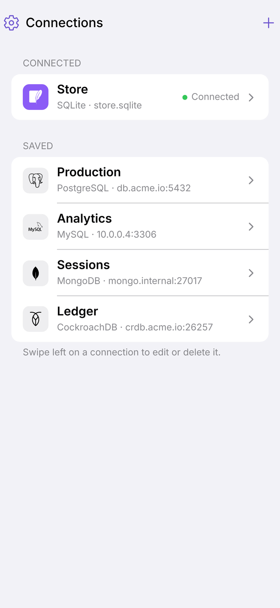
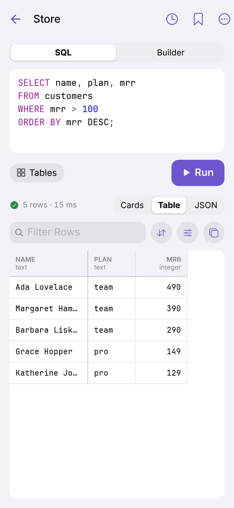
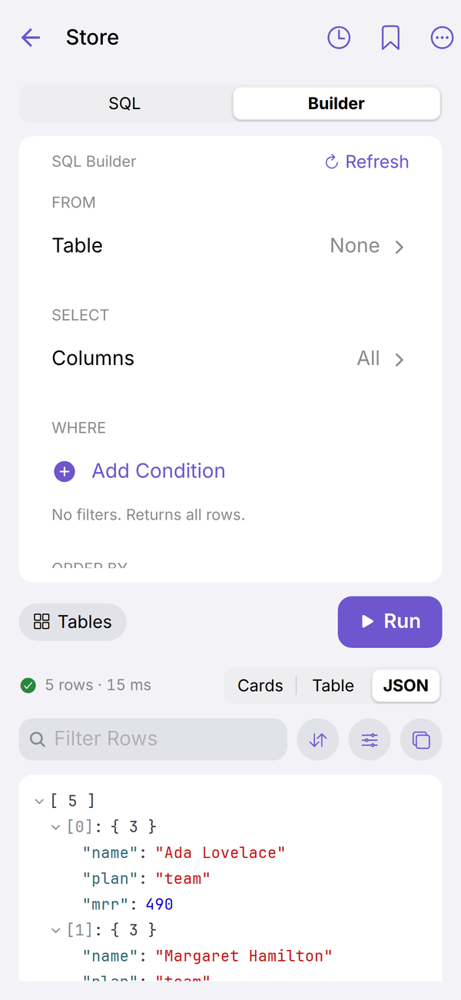
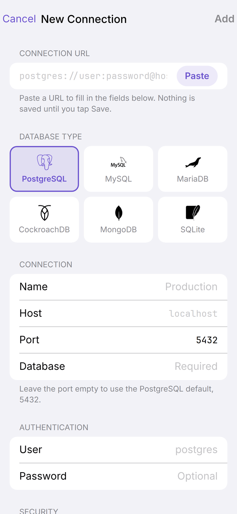
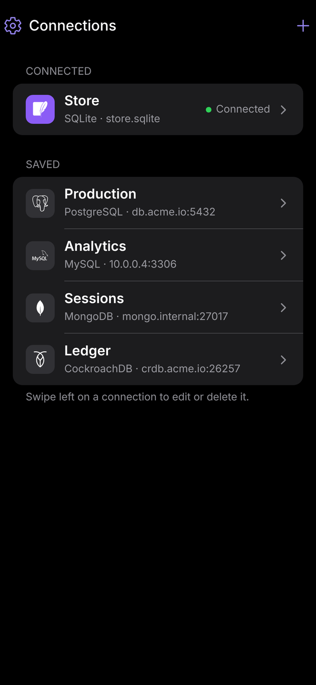
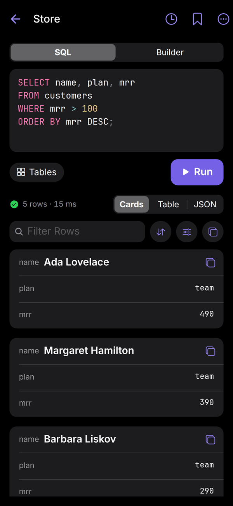
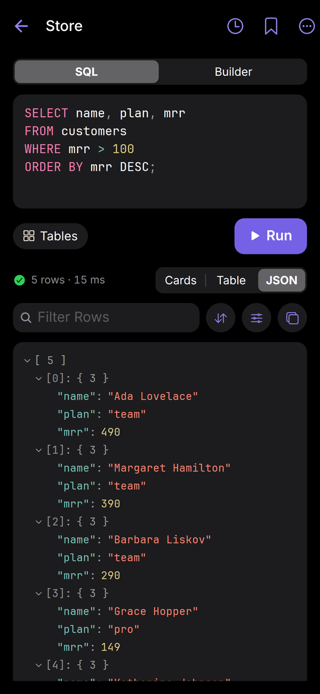
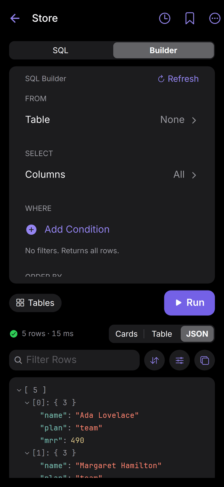

<p align="center">
  
</p>

<h1 align="center">COSMQ</h1>

<p align="center">
  Query PostgreSQL, MySQL, MongoDB and SQLite from your phone.<br />
  Open source, native on iOS and Android. Pronounced "cosmic".
</p>

<p align="center">
  <a href="https://github.com/arioberek/COSMQ/actions/workflows/ci.yml"></a>
  <a href="LICENSE"></a>
  
  
</p>

COSMQ (**C**lient **O**pen-**S**ource **M**obile **Q**uery) is a database client for your phone. It talks to PostgreSQL, MySQL, MariaDB, CockroachDB and MongoDB over their own wire protocols, straight over TCP from the device, and opens SQLite files locally. There is no proxy, REST gateway or account in between: your credentials and queries go only to the database you point it at.

## Screenshots

<p align="center">
  
  
  
  
</p>

<p align="center">
  
  
  
  
</p>

## See it in motion

<p align="center">
  <a href="https://github.com/arioberek/COSMQ/raw/main/media/explainer/out/cosmq-explainer.mp4">
    
  </a>
  <br />
  <sub><a href="https://github.com/arioberek/COSMQ/raw/main/media/explainer/out/cosmq-explainer.mp4">Watch the 45-second tour (MP4)</a> · made with <a href="media/explainer">Remotion</a>, source in this repo</sub>
</p>

## Database support

| Engine | Auth | TLS | Schema browser | Transactions |
| --- | --- | --- | --- | --- |
| PostgreSQL | Cleartext, MD5, SCRAM-SHA-256 | Yes¹ | Tables, views, columns | Yes |
| MySQL / MariaDB | `mysql_native_password`, `caching_sha2_password` | Yes¹ | Tables, views, columns | Yes |
| CockroachDB | PostgreSQL wire protocol | Yes¹ | Tables, views, columns | Yes |
| MongoDB | SCRAM-SHA-1 | Yes | Collections, sampled fields | n/a |
| SQLite | n/a (on-device file) | n/a | Tables, views, columns | Yes |

¹ TLS is negotiated the way each server expects (PostgreSQL `SSLRequest`, MySQL `CLIENT_SSL`) and certificates are verified by default. When SSL is on, COSMQ never falls back to plaintext.

MongoDB queries are JSON database commands, for example `{"find": "users", "filter": {"active": true}, "limit": 20}`.

## Features

**Connections**
- Save PostgreSQL, MySQL, MariaDB, CockroachDB, MongoDB and SQLite connections, each with a color tag
- Paste a connection URL (`postgres://`, `mysql://`, `mongodb://` …) to fill in the form
- Test a connection before saving it; swipe a row to edit or delete it
- Pick a SQLite database from Files; the file is checked before it's opened

**Query editor**
- SQL syntax highlighting with a monospaced editor (JetBrains Mono)
- Context-aware keyword autocomplete (after `FROM`, inside `SET`, `WHERE`, `ORDER BY` …)
- Optional starter templates and keyword chips (toggle in Settings)
- Schema browser: list tables and views, expand one to see its columns, tap to insert a name

**Visual query builder**
- SQL builder: pick a table and columns, add `WHERE` conditions, `ORDER BY` and `LIMIT`
- MongoDB builder: pick a collection, projection, filter, sort and limit
- Switch between SQL and Builder at any time; the builder writes the query text for you

**Results**
- Cards, Table or JSON view, remembered per connection
- Filter rows, sort by any column, pin or hide columns (remembered per query)
- Row detail sheet: copy any value, or the whole row as JSON
- Copy the full result set to the clipboard as TSV

**Safety**
- Confirmation before `UPDATE`, `DELETE`, `DROP`, `TRUNCATE`, `ALTER`, `MERGE` or `REPLACE` runs, with the option to wrap it in a transaction
- Commit or roll back from a banner above the results
- Auto-rollback: an open transaction is rolled back when its timer runs out (5–300 seconds, default 20)

**History and snippets**
- The last 50 queries are kept on the device, deduplicated
- Save queries as named snippets

**App**
- Appearance follows the system, or force Light or Dark
- Biometric app lock (Face ID, Touch ID, fingerprint) that locks immediately or after 15 seconds, 1 minute or 5 minutes in the background
- Haptic feedback on success, errors and transaction events (can be turned off)
- Animations respect Reduce Motion

## Install

The App Store release is coming soon. Until then, build it from source (below).

## Development

Requirements: [Bun](https://bun.sh) 1.2+, and Xcode (iOS) or Android Studio (Android).

```bash
bun install
bun run dev:mobile        # Expo dev server for apps/mobile
```

COSMQ uses native modules (TCP sockets, Keychain, biometrics), so it doesn't run in Expo Go. Build a development client once, then keep using the dev server:

```bash
cd apps/mobile
bunx expo run:ios         # or: bunx expo run:android
```

`ios/` and `android/` are generated by `expo prebuild` from `app.json` (Continuous Native Generation) and are not committed. Put native changes in `app.json` or a config plugin.

**Web preview.** `bunx expo start --web` renders the UI for layout checks only. TCP sockets, the Keychain and biometrics are native, so the web build can't connect to databases, and its secure store is in-memory (nothing persists).

**Test databases.** `docker compose up -d` at the repo root starts PostgreSQL, MySQL, MariaDB, CockroachDB and MongoDB locally. Credentials are in [`docker-compose.yml`](docker-compose.yml).

Before opening a PR, run `bun run lint`, `bun run typecheck` and `bun run build`. The monorepo uses Bun workspaces, Turborepo and Biome.

**Design.** The app follows Apple's Human Interface Guidelines with one violet accent. Tokens, typography and components are documented in [docs/design-system.md](docs/design-system.md).

**Releasing.** iOS builds are made and submitted to TestFlight by an EAS Workflow. Signing credentials and API keys live on EAS, never in this repo. See [docs/RELEASING.md](docs/RELEASING.md).

## Architecture

```text
expo-router screens (app/)
        │
        ▼
Zustand stores ──────────────► storage
(connection, settings)          ├─ Keychain (expo-secure-store): passwords, history, snippets, settings
        │                       └─ AsyncStorage: connection metadata, results view prefs
        ▼
DatabaseConnection interface
  ├─ PostgreSQL / CockroachDB  (Postgres v3 protocol, SCRAM)
  ├─ MySQL / MariaDB           (MySQL client/server protocol)
  ├─ MongoDB                   (OP_MSG + BSON)
  │       │
  │       ▼
  │  react-native-tcp-socket (TCP / TLS)  ──►  database server
  │
  └─ SQLite                    (expo-sqlite, on-device file)
```

Every engine implements the same `DatabaseConnection` interface (`connect`, `query`, `listTables`, `describeTable`, …), so screens don't care which database is on the other end.

## Repo layout

```text
apps/
  mobile/                 Expo app (iOS, Android; web for UI previews)
    app/                  expo-router screens: connections, connection form and detail, query, settings
    components/
      ui/                 design-system primitives (AppText, ListSection/ListRow, Button, Switch, Dialog)
      query/              SQL editor, autocomplete, toolbar, tables panel, history and snippets sheets
      results/            Cards, Table and JSON views, sort, filter, column customization
      builder/            visual SQL and MongoDB query builders
      connection/         connection form fields, database type and color pickers
    lib/
      protocols/          postgres, mysql, mongodb, sqlite
      tcp/                TCP/TLS socket wrapper
      sql/                tokenizer, autocomplete, presets, transactions
      storage/            connections, history, snippets, settings, results prefs
    stores/               Zustand stores
    hooks/                theme and color scheme hooks
    tamagui.config.ts     design tokens and light/dark themes
    .eas/workflows/       EAS release workflow
  landing/                marketing site (Astro)
packages/
  tsconfig/               shared TypeScript config
docs/                     design system, releasing, branch protection
media/explainer/          Remotion source for the explainer video (not part of the app build)
docker-compose.yml        local test databases
```

## Roadmap

Not shipped yet:

- `mongodb+srv://` (DNS seed list) connections
- SSH tunneling
- Export results to a file (CSV, JSON, SQL `INSERT`)
- Pagination for large result sets
- `EXPLAIN` / query plan viewer
- Schema diff between connections
- Opt-in, end-to-end encrypted sync of connections

## Security

Treat COSMQ like any other database client.

- Passwords are stored in the iOS Keychain or Android Keystore, never in logs.
- Use TLS for anything beyond your local network.
- Prefer read-only database users when working from your phone.
- Turn on the biometric app lock if the device holds production credentials.

Please report vulnerabilities privately as described in [SECURITY.md](SECURITY.md), not in a public issue.

## Contributing

Issues and pull requests are welcome. [CONTRIBUTING.md](CONTRIBUTING.md) covers setup, branch and commit conventions, and review.

## License

[MIT](LICENSE)
